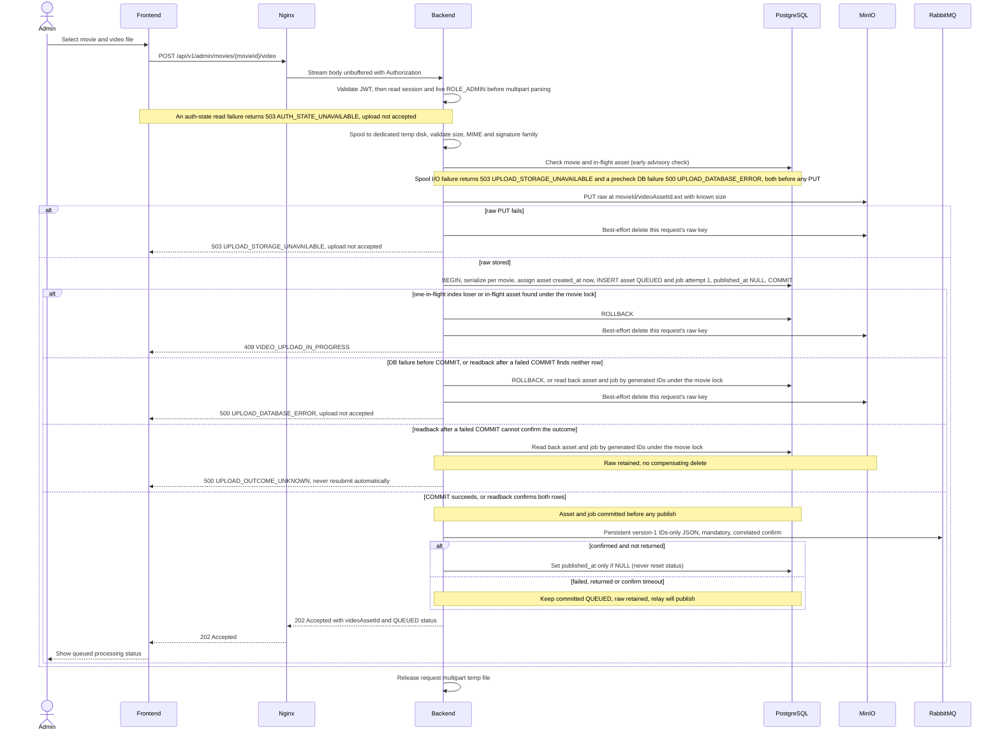
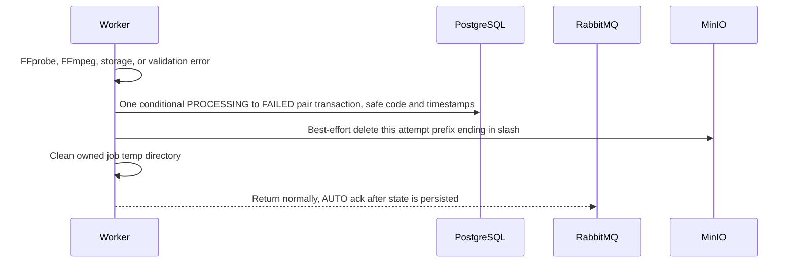
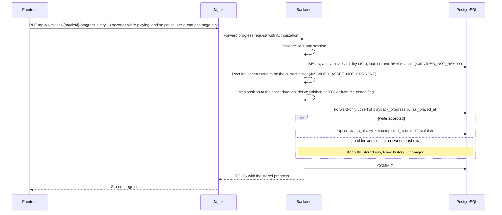
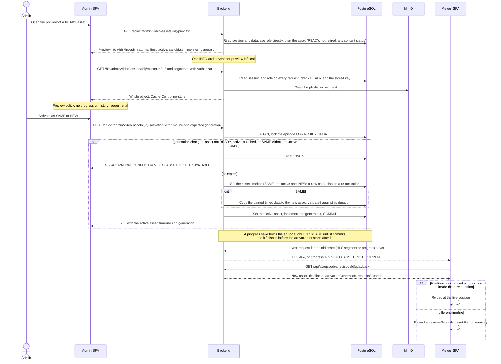
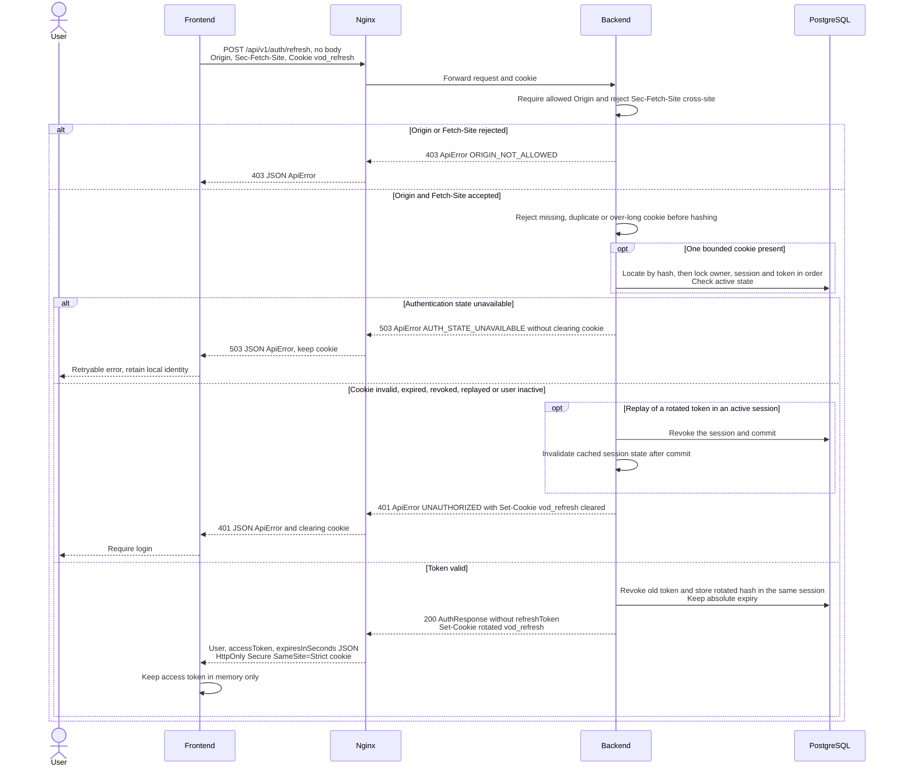
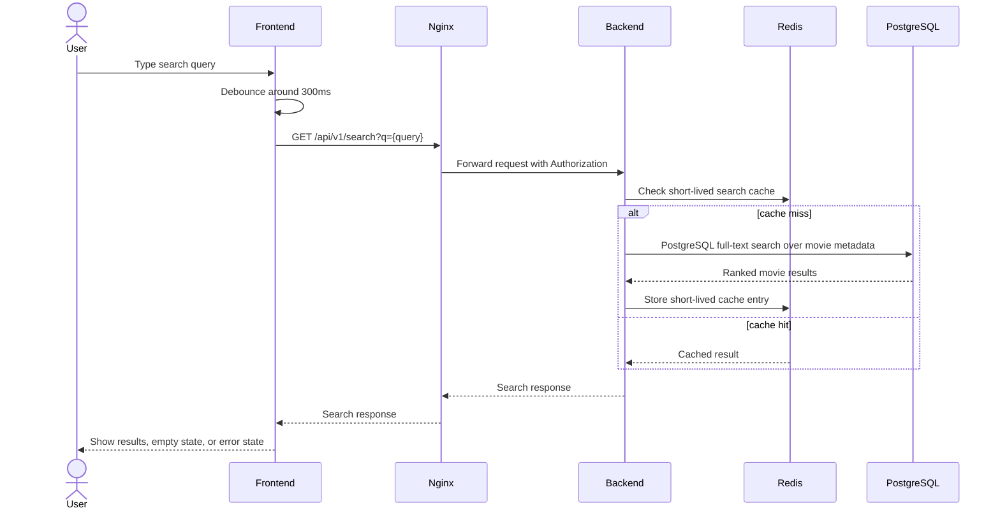

# Sequence Diagrams

Status: Frozen for MVP implementation

These diagrams define the frozen MVP runtime flows. They are architecture contracts, not implementation code.

## Admin Upload



The SPA pre-check GET uses the existing auth refresh path, validates file size/type, and shows XHR progress. At 100% it shows “Saving to storage…” without Cancel; no automatic body replay after 401. `202` is the committed acceptance snapshot; a fast worker may already have advanced the DB status. Keep raw while a commit outcome is unknown (`UPLOAD_OUTCOME_UNKNOWN`); compensate only after a failed raw PUT or after establishing the transaction did not commit. Upload error bodies are `ApiError` with `requestId`. UPLOADED is reserved. Edge/body-limit details are in [INFRASTRUCTURE.md](INFRASTRUCTURE.md#upload-transport).

### Unpublished-job relay

```mermaid
sequenceDiagram
    participant Backend
    participant PostgreSQL
    participant RabbitMQ
    Backend->>PostgreSQL: Select oldest QUEUED, published_at NULL, age at least twice confirm timeout
    loop every ENCODING_RELAY_INTERVAL_SECONDS (default 10)
        Backend->>RabbitMQ: Republish same persistent message, mandatory and confirm
        alt confirmed and not returned
            Backend->>PostgreSQL: Set published_at if NULL, without status write
        else unavailable or timeout
            Note over Backend,PostgreSQL: Leave pending; no FAILED and no QUEUED age timeout
        end
    end
```

The single-backend relay closes the commit/publish crash window; a confirm/DB-write crash may duplicate delivery. [ADR-010](adr/ADR-010.md) defines the conditional claim that makes duplication safe.

## Worker Encoding

```mermaid
sequenceDiagram
    participant RabbitMQ
    participant Worker
    participant PostgreSQL
    participant MinIO
    participant FFprobe
    participant FFmpeg

    Note over Worker,PostgreSQL: Before listener start: sweep owned temp dirs, fail PROCESSING orphans WORKER_INTERRUPTED, clean attempt prefixes
    RabbitMQ-->>Worker: Deliver versioned IDs-only job (prefetch 1, concurrency 1)
    Worker->>PostgreSQL: Validate IDs/attempt, load trusted raw key, conditionally claim latest QUEUED pair in one JDBC transaction
    opt claim COMMIT outcome unknown
        Worker->>PostgreSQL: On DB reconnect, read back job/asset pair and latest attempt
        Note over Worker,PostgreSQL: Matching latest PROCESSING pair is our own claim; continue, no re-claim or early ack
        Note over Worker,PostgreSQL: Matching QUEUED pair retries claim; unresolved state holds delivery, never ack from non-QUEUED alone
    end
    alt terminal pair, different attempt or newer job
        Worker-->>RabbitMQ: Return normally, AUTO ack and skip
    else malformed, unsupported version or mismatched IDs
        Worker-->>RabbitMQ: Reject without requeue to queue-derived DLX/DLQ
    else readback unresolved or matching pair still QUEUED
        Note over Worker,PostgreSQL: Hold delivery, retry readback or conditional claim; no ack or media work yet
    else claim confirmed or matching latest PROCESSING readback owns claim
        Note over Worker,PostgreSQL: Commit claim; no transaction during media work
        Worker->>MinIO: Check disk from raw size plus reserve, bounded download into job directory
        Worker->>FFprobe: Forced trusted demuxer, file protocol, capped output and deadline
        FFprobe-->>Worker: Metadata, checked against caps and stream/duration rules
        Worker->>Worker: Check disk for the output budget
        Worker->>FFmpeg: Typed arguments, same input restrictions, single-quality HLS and deadline
        FFmpeg-->>Worker: master.m3u8 with relative segments/ URIs
        Worker->>Worker: Validate playlist (VOD, ENDLIST, segments present, duration vs probe)
        Worker->>Worker: Delete downloaded raw copy
        Worker->>MinIO: Upload under video-assets/assetId/attempt-n/ only
        Worker->>PostgreSQL: One conditional PROCESSING to READY pair transaction, metadata and HLS keys
        alt finish genuinely lost expected state
            Worker->>PostgreSQL: Read back pair, exclude same-attempt READY after ambiguous commit
            Worker->>MinIO: Best-effort delete only unreferenced losing attempt prefix
        end
        Worker->>Worker: Clean owned job temp directory
        Worker-->>RabbitMQ: Return normally, AUTO ack after persisted outcome
    end
```

Failure path:



DB unavailability at claim or finish holds delivery and retries in-process with capped backoff; it is neither FAILED nor a poison DLQ case. A startup crash is bounded by failing the orphan on restart. Only one non-overlapping worker replica is permitted. See the [recovery runbook](../deployment/README.md#encoding-recovery); every external step needs a deadline and QUEUED age never causes failure.

An ambiguous claim COMMIT that readback identifies as this delivery's PROCESSING pair must proceed through probe/encode to READY; the single non-overlapping worker invariant supplies ownership without a claim-token column. Never skip it just because a repeated QUEUED update returned zero rows.

Read back uncertain finish commit outcomes before cleanup: if this attempt already reached READY with its expected HLS keys, acknowledge success and retain those objects. DB outage alone does not stop the listener/worker or trigger startup orphan recovery; the #74 4.4 classic baseline evaluates no consumer timeout.

## Admin Retry Failed Encoding

```mermaid
sequenceDiagram
    actor Admin
    participant Frontend
    participant Nginx
    participant Backend
    participant PostgreSQL
    participant RabbitMQ

    Admin->>Frontend: Click retry on failed video asset
    Frontend->>Nginx: POST /api/v1/admin/video-assets/{videoAssetId}/retry
    Nginx->>Backend: Forward request with Authorization
    Backend->>Backend: Validate JWT, then read session and live ROLE_ADMIN
    Backend->>PostgreSQL: BEGIN, same movie-row lock as upload commit, load newest asset/latest attempt
    alt requested asset is newest FAILED and conditional claim wins
        Backend->>PostgreSQL: Conditionally FAILED to QUEUED, clear failure, insert next QUEUED attempt with published_at NULL
        Backend->>PostgreSQL: COMMIT both rows
        Backend->>RabbitMQ: Version-1 IDs-only JSON, mandatory and correlated confirm
        Backend->>PostgreSQL: On confirm only, set published_at if NULL without status overwrite
        Note over Backend,PostgreSQL: Publish failure still returns 202; relay owns recovery
        Backend-->>Nginx: 202 Accepted with QUEUED status
        Nginx-->>Frontend: 202 Accepted
        Frontend-->>Admin: Show retry queued
    else not newest FAILED or another retry won
        Backend->>PostgreSQL: ROLLBACK
        Backend-->>Nginx: 409 VIDEO_ASSET_NOT_RETRYABLE
        Nginx-->>Frontend: 409 Conflict
        Frontend-->>Admin: Show retry not available
    end
```

## Playback

```mermaid
sequenceDiagram
    actor User
    participant Frontend
    participant Nginx
    participant Backend
    participant PostgreSQL
    participant MinIO

    User->>Frontend: Open watch page
    Frontend->>Nginx: GET /api/v1/movies/{movieId}/playback
    Nginx->>Backend: Forward request with Authorization
    Backend->>Backend: Validate JWT and session
    Backend->>PostgreSQL: Apply movie visibility first, then load newest READY by created_at/id and saved progress
    Note over Backend,PostgreSQL: Hidden/missing movie is 404; no current asset is 409 VIDEO_NOT_READY
    Backend-->>Nginx: Playback info with /hls/video-assets/{videoAssetId}/master.m3u8
    Nginx-->>Frontend: Playback info
    Frontend->>Nginx: GET /hls/video-assets/{videoAssetId}/master.m3u8 with Authorization
    Nginx->>Backend: Forward HLS request with Authorization
    Backend->>Backend: Validate JWT and session<br/>Apply visibility and current READY asset checks (else 404)
    Backend->>MinIO: Read master at stored attempt-scoped key
    Backend-->>Nginx: HLS playlist with MIME type
    Nginx-->>Frontend: HLS playlist
    Frontend->>Nginx: GET /hls/video-assets/{videoAssetId}/segments/{segmentName} with Authorization
    Nginx->>Backend: Forward HLS segment request
    Backend->>Backend: Validate JWT and session<br/>Check visibility, current READY asset and segmentName (else 404)
    Backend->>MinIO: Read segment under prefix derived from stored master key
    Backend-->>Nginx: HLS segment with MIME type
    Nginx-->>Frontend: HLS segment
    opt access token expired during playback
        Backend-->>Frontend: 401 on a playlist or segment request
        Frontend->>Frontend: Shared single-flight token refresh, once
        Frontend->>Nginx: Retry that request once with the new token
        Note over Frontend: A second 401 or a refresh 401 ends the session<br/>Network errors, timeouts and 5xx remain retryable (ADR-011 D2, ADR-012 D7)
    end
```

The player is hls.js only and never uses native HLS playback; every HLS request carries the current token in the `Authorization` header, never in the URL. HLS responses are whole objects with `Cache-Control: no-store`. [ADR-011](adr/ADR-011.md) defines the player rules, the error mapping and the start position.

## Playback Progress



Progress is committed to PostgreSQL before the response; there is no Redis buffer or flush job ([ADR-011 D9](adr/ADR-011.md#playback-progress-d9-d14)). The playback API, the progress `GET` and continue-watching read the same rows and normalize them against the current asset in the same way, so a reload resumes from the last accepted update. The player sends at most one save at a time, so a save delayed by a token refresh cannot overwrite a newer one; between tabs or devices the last save to arrive wins.

Planned ([ADR-013](adr/ADR-013.md)): from S2 the playback and progress routes take an `episodeId` (`/api/v1/episodes/{episodeId}/...`) and every check above applies to the episode and its current asset. From S5 the save first locks the episode row `FOR SHARE` and also requires the request's `activationGeneration`; see the next diagram.

## Asset Activation and Admin Preview (planned, ADR-013 S5)



The viewer routes never serve a candidate. Activation runs no storage I/O inside its transaction, and the worker takes no part in it. [ADR-013 D7-D9](adr/ADR-013.md#d7-activation-s5) define the rules, including re-activation of an earlier asset.

## Auth Refresh



The host-only cookie has `Path=/api/v1/auth` and a `Max-Age` equal to the remaining absolute session lifetime.
An authentication-state outage keeps the cookie and leaves the request retryable. See [ADR-012](adr/ADR-012.md).

## Search


