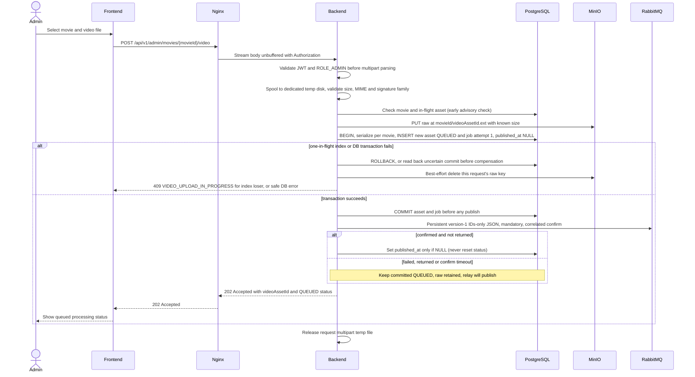
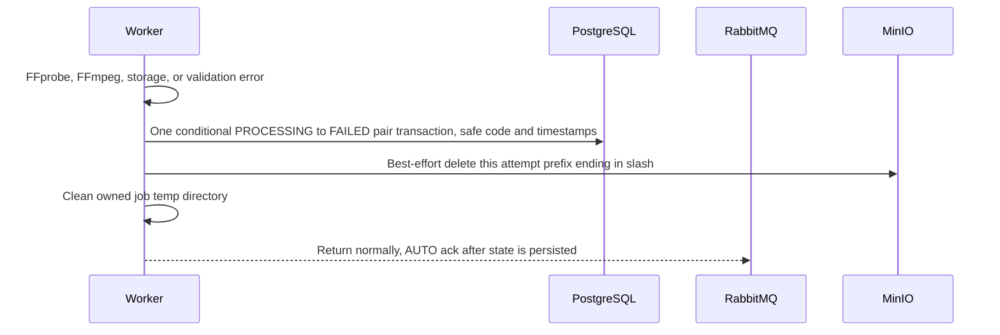
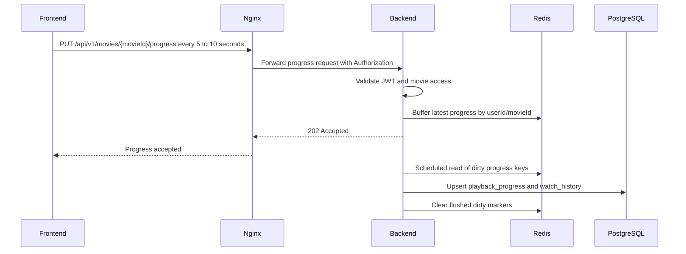
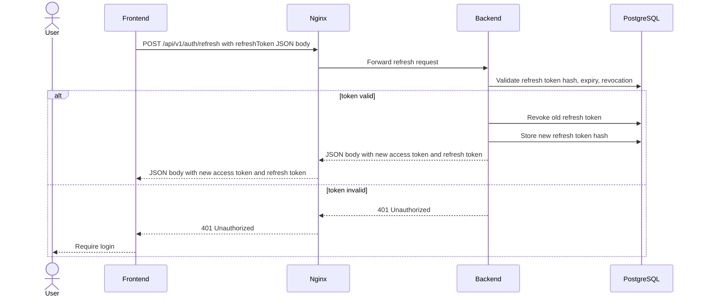
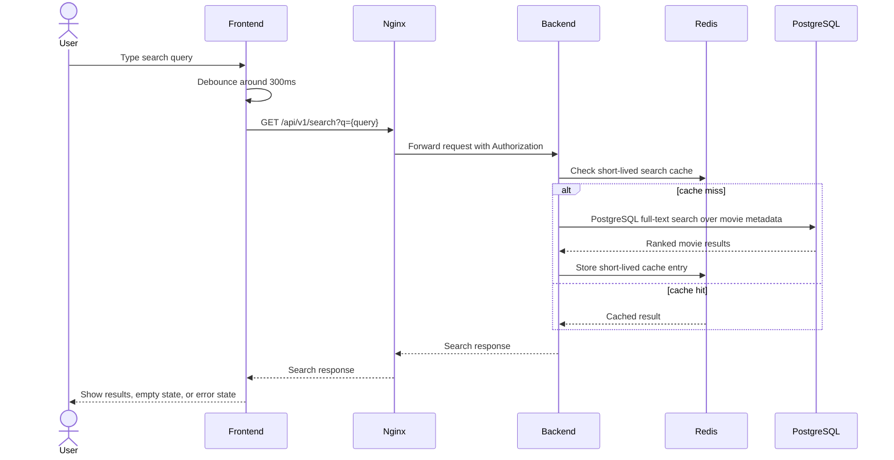

# Sequence Diagrams

Status: Frozen for MVP implementation

These diagrams define the frozen MVP runtime flows. They are architecture contracts, not implementation code.

## Admin Upload



The SPA pre-check GET uses the existing auth refresh path, validates file size/type, and shows XHR progress. At 100% it shows “Saving to storage…” without Cancel; no automatic body replay after 401. `202` is the committed acceptance snapshot; a fast worker may already have advanced the DB status. Keep raw while a commit outcome is unknown; compensate only after establishing the transaction did not commit. UPLOADED is reserved. Edge/body-limit details are in [INFRASTRUCTURE.md](INFRASTRUCTURE.md#upload-transport).

### Unpublished-job relay

```mermaid
sequenceDiagram
    participant Backend
    participant PostgreSQL
    participant RabbitMQ
    Backend->>PostgreSQL: Select oldest QUEUED, published_at NULL, age at least twice confirm timeout
    loop every ENCODING_RELAY_INTERVAL_SECONDS (default 10)
        Backend->>RabbitMQ: Republish same persistent message, mandatory and confirm
        alt confirmed and not returned
            Backend->>PostgreSQL: Set published_at if NULL, without status write
        else unavailable or timeout
            Note over Backend,PostgreSQL: Leave pending; no FAILED and no QUEUED age timeout
        end
    end
```

The single-backend relay closes the commit/publish crash window; a confirm/DB-write crash may duplicate delivery. [ADR-010](adr/ADR-010.md) defines the conditional claim that makes duplication safe.

## Worker Encoding

```mermaid
sequenceDiagram
    participant RabbitMQ
    participant Worker
    participant PostgreSQL
    participant MinIO
    participant FFprobe
    participant FFmpeg

    Note over Worker,PostgreSQL: Before listener start: sweep owned temp dirs, fail PROCESSING orphans WORKER_INTERRUPTED, clean attempt prefixes
    RabbitMQ-->>Worker: Deliver versioned IDs-only job (prefetch 1, concurrency 1)
    Worker->>PostgreSQL: Validate IDs/attempt, load trusted raw key, conditionally claim latest QUEUED pair in one JDBC transaction
    alt duplicate, terminal or older valid attempt
        Worker-->>RabbitMQ: Return normally, AUTO ack and skip
    else malformed, unsupported version or mismatched IDs
        Worker-->>RabbitMQ: Reject without requeue to queue-derived DLX/DLQ
    else claimed
        Note over Worker,PostgreSQL: Commit claim; no transaction during media work
        Worker->>MinIO: Check disk from raw size, bounded download into job directory
        Worker->>FFprobe: Forced trusted demuxer, file protocol, capped output and deadline
        FFprobe-->>Worker: Metadata, checked against caps
        Worker->>FFmpeg: Typed arguments, same input restrictions, single-quality HLS and deadline
        FFmpeg-->>Worker: master.m3u8 with relative segments/ URIs
        Worker->>Worker: Delete downloaded raw copy
        Worker->>MinIO: Upload under video-assets/assetId/attempt-n/ only
        Worker->>PostgreSQL: One conditional PROCESSING to READY pair transaction, metadata and HLS keys
        alt finish genuinely lost expected state
            Worker->>PostgreSQL: Read back pair, exclude same-attempt READY after ambiguous commit
            Worker->>MinIO: Best-effort delete only unreferenced losing attempt prefix
        end
        Worker->>Worker: Clean owned job temp directory
        Worker-->>RabbitMQ: Return normally, AUTO ack after persisted outcome
    end
```

Failure path:



DB unavailability at claim or finish holds delivery and retries in-process with capped backoff; it is neither FAILED nor a poison DLQ case. A startup crash is bounded by failing the orphan on restart. Only one non-overlapping worker replica is permitted. See the [recovery runbook](../deployment/README.md#encoding-recovery); every external step needs a deadline and QUEUED age never causes failure.

Read back uncertain commit outcomes before cleanup: if this attempt already reached READY with its expected HLS keys, acknowledge success and retain those objects. Total DB retry time is bounded by the whole-job budget in Issue 5.7; on exhaustion stop the listener/worker without ack or poison rejection, then use startup recovery.

## Admin Retry Failed Encoding

```mermaid
sequenceDiagram
    actor Admin
    participant Frontend
    participant Nginx
    participant Backend
    participant PostgreSQL
    participant RabbitMQ

    Admin->>Frontend: Click retry on failed video asset
    Frontend->>Nginx: POST /api/v1/admin/video-assets/{videoAssetId}/retry
    Nginx->>Backend: Forward request with Authorization
    Backend->>Backend: Validate JWT and ROLE_ADMIN
    Backend->>PostgreSQL: BEGIN, same movie-row lock as upload commit, load newest asset/latest attempt
    alt requested asset is newest FAILED and conditional claim wins
        Backend->>PostgreSQL: Conditionally FAILED to QUEUED, clear failure, insert next QUEUED attempt with published_at NULL
        Backend->>PostgreSQL: COMMIT both rows
        Backend->>RabbitMQ: Version-1 IDs-only JSON, mandatory and correlated confirm
        Backend->>PostgreSQL: On confirm only, set published_at if NULL without status overwrite
        Note over Backend,PostgreSQL: Publish failure still returns 202; relay owns recovery
        Backend-->>Nginx: 202 Accepted with QUEUED status
        Nginx-->>Frontend: 202 Accepted
        Frontend-->>Admin: Show retry queued
    else not newest FAILED or another retry won
        Backend->>PostgreSQL: ROLLBACK
        Backend-->>Nginx: 409 VIDEO_ASSET_NOT_RETRYABLE
        Nginx-->>Frontend: 409 Conflict
        Frontend-->>Admin: Show retry not available
    end
```

## Playback

```mermaid
sequenceDiagram
    actor User
    participant Frontend
    participant Nginx
    participant Backend
    participant PostgreSQL
    participant MinIO

    User->>Frontend: Open watch page
    Frontend->>Nginx: GET /api/v1/movies/{movieId}/playback
    Nginx->>Backend: Forward request with Authorization
    Backend->>Backend: Validate JWT and access rules
    Backend->>PostgreSQL: Apply movie visibility first, then load newest READY by created_at/id and saved progress
    Note over Backend,PostgreSQL: Hidden/missing movie is 404; no current asset is 409 VIDEO_NOT_READY
    Backend-->>Nginx: Playback info with /hls/video-assets/{videoAssetId}/master.m3u8
    Nginx-->>Frontend: Playback info
    Frontend->>Nginx: GET /hls/video-assets/{videoAssetId}/master.m3u8 with Authorization
    Nginx->>Backend: Forward HLS request with Authorization
    Backend->>Backend: Validate JWT, visibility and current READY asset (else 404)
    Backend->>MinIO: Read master at stored attempt-scoped key
    Backend-->>Nginx: HLS playlist with MIME type
    Nginx-->>Frontend: HLS playlist
    Frontend->>Nginx: GET /hls/video-assets/{videoAssetId}/segments/{segmentName} with Authorization
    Nginx->>Backend: Forward HLS segment request
    Backend->>Backend: Validate JWT, visibility, current READY asset and segmentName (else 404)
    Backend->>MinIO: Read segment under prefix derived from stored master key
    Backend-->>Nginx: HLS segment with MIME type
    Nginx-->>Frontend: HLS segment
```

## Playback Progress



## Auth Refresh



## Search


